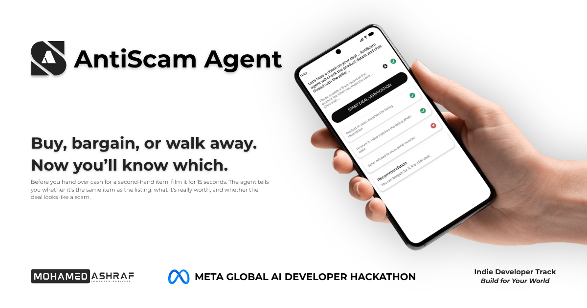
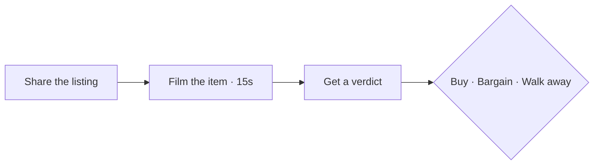

<p align="center">
  
</p>

<p align="center">
  
  
  
  
</p>

<p align="center"><strong>Share the listing. Film the item. Get a verdict before you pay.</strong></p>

<p align="center">
  <a href="#the-problem">Problem</a> ·
  <a href="#the-solution">Solution</a> ·
  <a href="#how-it-works">How it works</a> ·
  <a href="#what-you-get">Verdict</a> ·
  <a href="#built-with">Stack</a> ·
  <a href="#getting-started">Getting started</a>
</p>

---

## The problem

**You're about to pay a stranger for something you can't verify.**

Buying second-hand on Marketplace means trusting a few photos and a chat. Is this the bike in the listing? Is £180 fair? Is the seller even real? People decide in a car park in two minutes — or they pay by bank transfer without ever seeing the item.

The second case is where most money disappears.

> A warning alone doesn't work. Proof does.

Santander's own data shows why. Between December 2023 and May 2024, **263 of 439** Marketplace scam victims first admitted they hadn't seen the item, then changed their answer so the payment would go through. People want the deal badly enough to override a warning.

| Santander Marketplace checks (Dec 2023 – May 2024) | Figure |
| --- | ---: |
| Payments stopped after buyers admitted they hadn't seen the item | 1,899 |
| Customers who still fell victim | 439 |
| Of those, buyers who changed their answer to force the payment through | **263** |
| Average loss per victim | **£647** |

Source: [Santander UK](https://www.santander.co.uk/about-santander/media-centre/press-releases/over-1800-customers-saved-from-potential-facebook)

---

## The solution

Before you hand over cash for a second-hand item, film it for 15 seconds. The agent tells you whether it's the same item as the listing, what it's really worth, and whether the deal looks like a scam.

Built for Facebook Marketplace, eBay, Vinted, and other second-hand platforms.

---

## How it works

| Step | You do | The agent does |
| :---: | --- | --- |
| **1** | Share the listing | Reads the photos, price, and description |
| **2** | Film the real item for 15 seconds | Compares what is in front of you with what was advertised |
| **3** | Review the verdict | Match, fair value, and scam risk — before you pay |



---

## What you get

Three answers. One decision.

| Check | Question it answers |
| --- | --- |
| **Match** | Is this the same item as the listing? |
| **Value** | What is it really worth? |
| **Risk** | Does this deal look like a scam? |

Use that to **buy**, **bargain**, or **walk away** — with evidence, not a gut feeling.

---

## Built with

| Layer | Choice |
| --- | --- |
| Language | Kotlin 2.4 |
| UI | Jetpack Compose · Material 3 |
| Platform | Android 7.0+ (API 24) |
| Build | Android Gradle Plugin 9.4 · JDK 11 |

---

## Getting started

**Requirements:** [Android Studio](https://developer.android.com/studio) · JDK 11 · Android device or emulator (API 24+)

```bash
git clone https://github.com/mohamedXashraf/anti-scam-agent.git
cd anti-scam-agent
```

Open the project in Android Studio, let Gradle sync, then run the `app` configuration on a device or emulator.

```bash
./gradlew :app:assembleDebug
```

---

## Project status

Early prototype for the **Meta Global AI Developer Hackathon** — Indie Developer Track, *Build for Your World*.

Core product flows (listing ingest, 15-second capture, and verdict) are in active development.

---

<p align="center">
  <sub>Built by <a href="https://mohamedashraf.tech/">Mohamed Ashraf</a> · Meta Global AI Developer Hackathon</sub>
</p>
