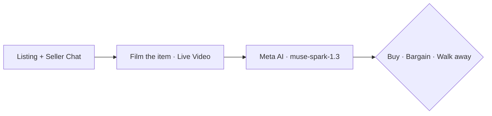
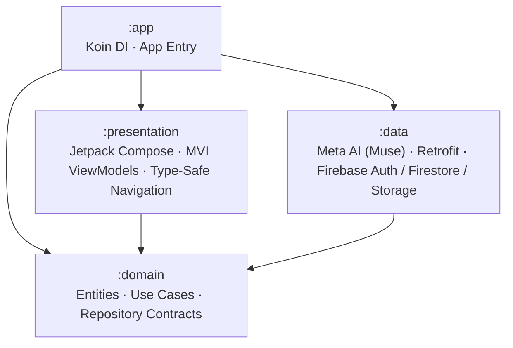

<p align="center">
  
</p>

<p align="center">
  
  
  
  
</p>

<p align="center"><strong>Share the listing. Film the item. Get a verdict before you pay.</strong></p>

<p align="center">
  <a href="#the-problem">Problem</a> ·
  <a href="#the-solution">Solution</a> ·
  <a href="#how-it-works">How it works</a> ·
  <a href="#ai-verification-pipeline">AI Pipeline</a> ·
  <a href="#architecture">Architecture</a> ·
  <a href="#built-with">Stack</a> ·
  <a href="#getting-started">Getting started</a>
</p>

---

## The problem

**You're about to pay a stranger for something you can't verify.**

Buying second-hand on Marketplace means trusting a few photos and a chat. Is this the bike in the listing? Is £180 fair? Is the seller even real? People decide in a car park in two minutes — or they pay by bank transfer without ever seeing the item.

The second case is where most money disappears.

> A warning alone doesn't work. Proof does.

Santander's own data shows why. Between December 2023 and May 2024, **263 of 439** Marketplace scam victims first admitted they hadn't seen the item, then changed their answer so the payment would go through. People want the deal badly enough to override a warning.

| Santander Marketplace checks (Dec 2023 – May 2024) | Figure |
| --- | ---: |
| Payments stopped after buyers admitted they hadn't seen the item | 1,899 |
| Customers who still fell victim | 439 |
| Of those, buyers who changed their answer to force the payment through | **263** |
| Average loss per victim | **£647** |

Source: [Santander UK](https://www.santander.co.uk/about-santander/media-centre/press-releases/over-1800-customers-saved-from-potential-facebook)

---

## The solution

Before you hand over cash for a second-hand item, film it on the spot. The agent cross-checks the listing details, seller chat history, listing photo, and your live video to tell you whether it's the same item, whether the price is fair, and whether the deal shows scam red flags.

To make end-to-end testing seamless, the app includes a **built-in Marketplace sandbox** with realistic listings and buyer–seller chat threads alongside the live camera verification agent.

---

## How it works

| Step | You do | The agent does |
| :---: | --- | --- |
| **1** | Select a listing & review the chat | Ingests the product photo, asking price, description, and seller conversation |
| **2** | Film the real item on meetup *(optional)* | Compares the live video of the physical item against what was advertised |
| **3** | Review the verdict | Returns pass/fail verification checks and a final **Buy**, **Bargain**, or **Scam** recommendation |



---

## What you get

Three answers. One decision.

| Check | Question it answers |
| --- | --- |
| **Match** | Does the item in the live video match the listing photo and description? |
| **Value** | Is the asking price fair for the item and its actual condition? |
| **Risk** | Do the seller chat thread, pricing, or visual cues look like a scam? |

Use that to **buy**, **bargain**, or **walk away** — with evidence, not a gut feeling.

---

## AI verification pipeline

Powered by the **Meta AI API (`muse-spark-1.3`)**, the agent evaluates up to four multimodal inputs in a single reasoning pass:

1. **Product Metadata**: Title, description, and asking price from Firestore.
2. **Seller Chat Thread**: Full timestamped conversation between buyer and seller to detect social engineering (e.g., upfront deposit demands, refusal to show serial numbers, urgency tactics).
3. **Listing Photo**: Downloaded from Firebase Storage and encoded as a Base64 data URI.
4. **Live Meetup Video**: Captured via the device camera, uploaded to `POST /v1/files` with a 1-hour TTL, referenced in `POST /v1/responses`, and immediately deleted via `DELETE /v1/files/{id}` after inference.

### Structured Verdict Output

```json
{
  "notes": [
    {
      "note": "Product in live video matches the listing photo and description",
      "accepted": true
    },
    {
      "note": "Seller requested a deposit before meetup in the chat thread",
      "accepted": false
    }
  ],
  "recommendation": "Bargain or proceed with caution — verify serial number in person before paying."
}
```

---

## Architecture

The project follows **Clean Architecture** with an **MVI (`ViewState` / `ViewIntent`)** presentation layer split across four Gradle modules:



| Module | Responsibility |
| --- | --- |
| **`:app`** | Application entrypoint (`MainActivity`, `App`) and Koin dependency injection graph (`appModule`, `dataModule`, `domainModule`) |
| **`:presentation`** | Jetpack Compose UI screens (`Splash`, `Login`, `Register`, `Verification`, `Home`, `ProductDetails`, `Chat`, `Agent`), MVI `BaseViewModel`, and type-safe Compose Navigation |
| **`:domain`** | Pure Kotlin models (`Product`, `ChatMessage`, `DealVerification`, `User`), domain errors, repository interfaces, and use cases (`StartAgenticDealVerification`, `GetMarketplaceProducts`, etc.) |
| **`:data`** | Meta AI `Muse` client (`muse-spark-1.3`), Retrofit/OkHttp networking, and Firebase (`Authentication`, `FireStoreDB`, `FirebaseStorage`) repository implementations |

---

## Built with

| Layer | Choice |
| --- | --- |
| **Language** | Kotlin 2.4 · Coroutines |
| **AI / Multimodal LLM** | Meta AI API (`muse-spark-1.3` via `/v1/responses` & `/v1/files`) |
| **UI** | Jetpack Compose · Material 3 · Coil |
| **Architecture & DI** | Clean Architecture · MVI · Koin · Type-Safe Compose Navigation |
| **Backend & Cloud** | Firebase Authentication · Cloud Firestore · Firebase Storage · Crashlytics |
| **Networking** | Retrofit 2 · OkHttp 3 · Gson |
| **Platform & Build** | Android 7.0+ (API 24–37) · Android Gradle Plugin 9.4 · JDK 11 |

---

## Getting started

**Requirements:** [Android Studio](https://developer.android.com/studio) · JDK 11 · Android device or emulator (API 24+)

### 1. Clone the repository

```bash
git clone https://github.com/mohamedXashraf/anti-scam-agent.git
cd anti-scam-agent
```

### 2. Configure your Meta AI API key

Add your Meta AI API key to your project `gradle.properties` (or global `~/.gradle/gradle.properties`):

```properties
MUSE_API_KEY="your_meta_ai_api_key_here"
```

### 3. Configure Firebase

Place your Firebase project's `google-services.json` inside the `app/` directory (`app/google-services.json`) with **Authentication (Email/Password)**, **Cloud Firestore**, and **Firebase Storage** enabled.

### 4. Build and run

Open the project in Android Studio, let Gradle sync, and run the `app` configuration on a device or emulator — or build from the terminal:

```bash
./gradlew :app:assembleDebug
```

---

## Project status

Built for the **Meta Global AI Developer Hackathon** — Indie Developer Track, *Build for Your World*.

**Implemented features:**
- Email/password authentication with email verification flow
- Built-in Marketplace feed, product details, and buyer–seller chat history inspection
- In-app camera permission handling and live `.mp4` meetup video capture
- Multimodal deal verification (`muse-spark-1.3`) combining listing metadata, seller chat, product photo, and live video into a pass/fail checklist and final recommendation

---

<p align="center">
  <sub>Built by <a href="https://mohamedashraf.tech/">Mohamed Ashraf</a> · Meta Global AI Developer Hackathon</sub>
</p>
